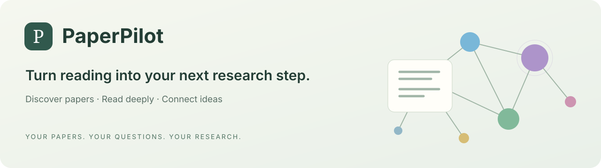
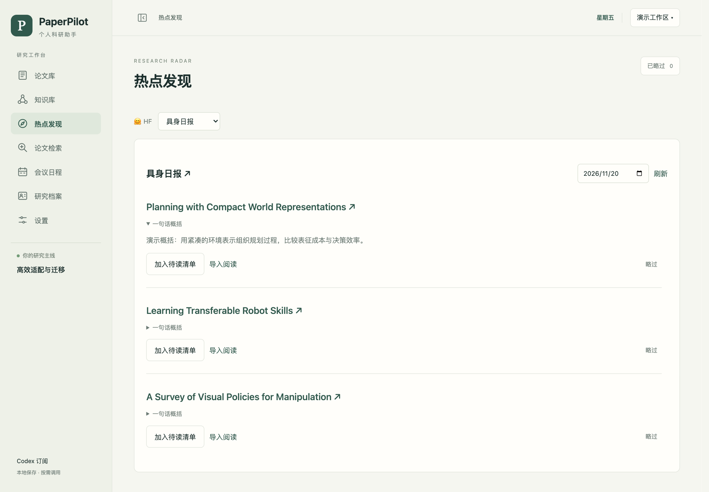
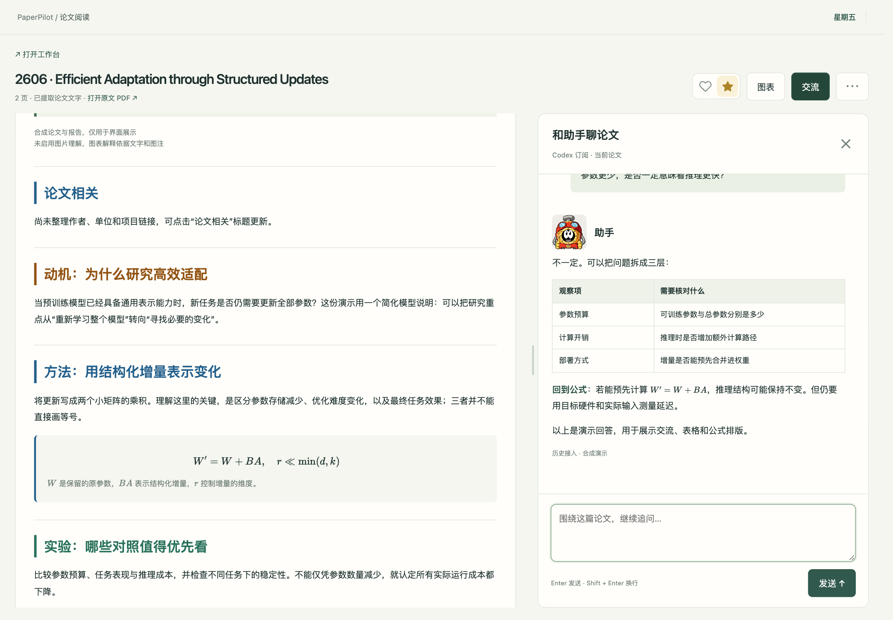
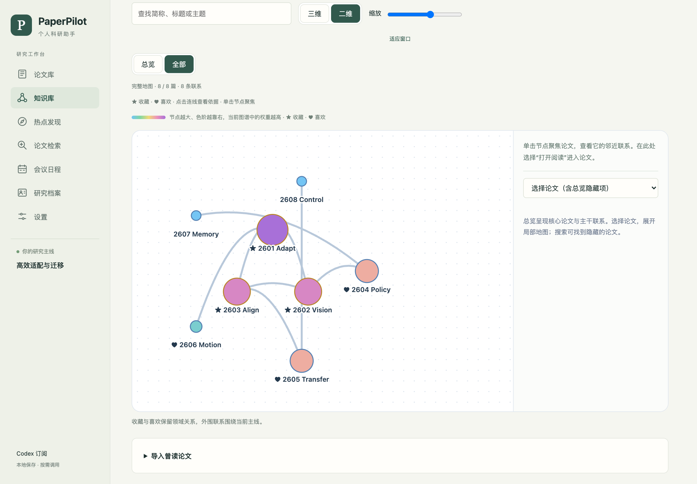

<p align="center">
  
</p>

<p align="center"><a href="README.md">简体中文</a> · <strong>English</strong></p>

<p align="center">
  <strong>Read papers in Chinese and build a knowledge graph around your research.</strong><br>
  A local-first research workspace powered by Codex or DeepSeek.
</p>

<p align="center">
  <a href="#highlights">Highlights</a> ·
  <a href="#daily-slides">Daily Papers & Slides</a> ·
  <a href="#preview">Preview</a> ·
  <a href="#quick-start">Quick Start</a> ·
  <a href="docs/GETTING_STARTED.md">Setup Guide (Chinese)</a> ·
  <a href="#contributing">Contributing</a>
</p>

<p align="center">Local storage &nbsp; / &nbsp; Codex · DeepSeek &nbsp; / &nbsp; macOS · Windows</p>

PaperPilot is a local research workspace for Chinese-speaking readers. Open an English paper and read the body in Chinese alongside the original figures, or switch to a reading report for an explanation of the method. Both views share the abstract and paper details.

For embodied AI researchers, reading can start before downloading the paper. Browse the daily slide decks to follow the field, then decide which papers belong in your personal knowledge graph.

| How you engage with a paper | Where it appears |
| --- | --- |
| **Browse the daily slides** to understand an idea or save it for later | Opening the deck or adding a paper to the reading queue leaves it outside the graph. |
| **Mark a paper as read** after working through it | It becomes a candidate for research threads where its content is relevant. |
| **♥ Like** a paper for a method, experiment, or perspective you want to revisit | It joins the long-term field graph. The expanded view includes Liked papers. |
| **★ Favorite** a paper you use as a lasting reference | It joins the same field graph and appears in the overview with the selected core connections. |

Liked and Favorite are alternative choices. Either can be set while reading. The reader and graphs work across research fields, while the daily feed and conference schedule focus on embodied AI.

<a id="highlights"></a>
## Why PaperPilot?

| What you want to do | How PaperPilot helps |
| --- | --- |
| **Understand a paper beyond its abstract** | Quick overview, detailed Chinese reading, and mathematical deep reading; distinct structures for research papers and surveys, with customizable narrative steps, formulas, and original figures. |
| **Ask questions and check the evidence** | Resizable, side-by-side reports and chat with Markdown / LaTeX support. Fix figure crops and captions while reading. |
| **Connect the papers you have read** | A two-layer knowledge graph: a long-term field backbone and separate research threads. Start with an overview, then focus on a paper to inspect its connections and evidence. |
| **Give the assistant research context** | Maintain your profile, research interests, and up to three research threads. Recommendations, reports, and chat use that context; paper-specific reflections also inform the graph. |
| **Discover embodied AI papers with slides ready to read** | Open pregenerated explanatory slides, presented as PDFs, from Embodied AI Daily Papers before deciding what deserves a deeper read. |
| **Make the tool your own** | Customize the source: adapt the interface, add paper sources, and extend reading workflows or modules, on your own or with coding assistants such as Codex. |
| **Keep a growing library manageable** | Reading, Read, Liked, and Favorites sections; import previously read papers, release original PDFs while keeping reports and their images, and restore PDFs later. |

<a id="preview"></a>
## From Reading to Research

These screenshots show the **actual interface with synthetic demo data**. Papers, reports, and graph connections illustrate interactions, not real research findings, model quality, or personal research records.

<a id="daily-slides"></a>
### 01 · Discover new papers with explanatory slides



**From embodied AI papers selected from Hugging Face, to prepared slides, to your own deep reading.** [Embodied AI Daily Papers](https://ipplab.github.io/embodied-ai-daily-papers/) is a separate public project maintained by the lab. PaperPilot brings it into your personal research workflow.

1. **Browse first.** Explore papers by date and expand summaries to judge their relevance.
2. **Read the explanation.** Click a paper title to open its prepared slide deck in PDF form. No additional slide-generation call is needed in PaperPilot.
3. **Make it part of your research.** Add interesting papers to your reading queue or import the originals, then read a Chinese translation or report, ask questions, and record your reflections.

For broader coverage, switch to the **full HF list** and use AI filtering based on your research interests and threads. The daily site provides shared explanations; PaperPilot supports your personal research work.

[Visit the daily site](https://ipplab.github.io/embodied-ai-daily-papers/) · [Source repository](https://github.com/iPPLab/embodied-ai-daily-papers) · [Introduction on Xiaohongshu (Chinese)](https://www.xiaohongshu.com/explore/6b002674000000002b01b47a)

> Slide availability depends on the external site's coverage and publishing progress. PaperPilot does not generate PPTs. Your own reading reports export as PDFs.

### 02 · Understand a paper and keep asking questions



- **Read the paper in Chinese.** Full-text translation starts with a whole-paper pass to align terminology, then translates the main text in order. Formulas and original figure and table images accompany Chinese captions. Switch between the translation and a separately saved reading report.
- **Choose the right reading structure.** Research papers follow motivation, method, experiments, and conclusions; surveys have a separate structure. Add, remove, or edit steps and save your preferred narrative.
- **Personalize mathematical explanations.** Upload a reference text and choose between reading it with each request or reusing an extracted style specification to reduce repeated input.
- **Check and correct figures.** Add, remove, or crop figures. Select caption text in the PDF or edit it by hand before translating it. High-resolution crops load on demand and can be adjusted directly from the report.
- **Keep working.** Open papers in separate tabs. Up to three report-generation tasks run concurrently; additional tasks queue. Stop generation, or stop and edit a mistakenly sent chat question.
- **Take your report with you.** Export existing reports as PDFs with Chinese text, formulas, and figures, without another model call.

### 03 · Connect papers around your research



The **field graph** organizes Favorites and Liked papers around relatively stable research interests. Each **research-thread graph** reuses that backbone and connects relevant Read papers to a specific project. Changing projects does not require rebuilding your long-term understanding from scratch.

| View | Purpose |
| --- | --- |
| **Overview** | See core papers and selected backbone edges without a wall of connections. |
| **All** | Expand the graph; research-thread graphs still filter for relevance to that thread. |
| **Focus on a paper** | Inspect neighbors, mechanisms or differences, evidence, and potential uses. An explicit “Open reading” action takes you to the report. |

Relationship analysis uses titles, abstracts, personal reflections, and saved reports. Without a report, it uses the PDF introduction, or explicitly identified opening excerpts when the introduction cannot be located. Available original material helps check claims. Facts, analogies, and unverified transfer ideas remain distinct.

Explore in 2D or 3D, update incrementally, or rebuild. Optional weekly updates check for missed work when the app reopens; nothing runs while the app is closed, and unchanged material does not trigger a model call. Failed generation preserves the previous graph; a successfully generated field backbone is saved independently.

### 04 · Find your next paper and plan ahead

- **Discovery:** switch between Embodied AI Daily Papers and the full HF list. The daily feed provides summaries and external explanations; the full list supports personalized AI filtering.
- **Paper search:** search by title, or discuss your research question with the assistant to develop recommendations. Save candidates to the reading queue before importing them.
- **Conference schedule:** track relevant conferences, abstract registration and full-paper deadlines, countdowns, official sources, and separate CCF / TH-CPL ratings. Follow one conference series, change time zones, and inspect past editions.
- **A simpler workspace:** hide navigation modules you do not use.

## Built for a Growing Library

**Organize reading and preference separately.** The reading queue holds candidates; Reading and Read track progress. ♥ Liked and ★ Favorites are mutually exclusive personal preferences. Previously read papers can be added with metadata and abstracts first, downloading PDFs when needed.

**Keep the originals you need.** Release PDFs or delete reading reports individually or in batches. Releasing an original preserves images required by existing reports. Restore a PDF from an available source or upload it manually; manual restoration takes priority. Regenerable high-resolution image caches share a **512 MiB limit per account**, excluding original PDFs, essential report images, and exports.

**Your data, your model access.** Local accounts keep papers, notes, graphs, and model settings separate. Optional persistent memory is off by default. Switching between Codex and DeepSeek preserves your material and current graphs and does not change shared generation rules.

<a id="quick-start"></a>
## Quick Start

Install from source with **Python 3.12, Node.js 22, and Git**:

```sh
git clone https://github.com/guoyuanhao-git/PaperPilot.git
cd PaperPilot
```

<details open>
<summary><strong>macOS</strong></summary>

```sh
python3 -m venv .venv
.venv/bin/python -m pip install -r requirements.txt
npm ci
npx playwright install chromium
./run.sh
```

After setup, double-click `PaperPilot.app` or `启动 PaperPilot.command` to start. Use `停止 PaperPilot.command` to stop the service.

</details>

<details>
<summary><strong>Windows · PowerShell</strong></summary>

```powershell
py -3.12 -m venv .venv
.\.venv\Scripts\python.exe -m pip install -r requirements.txt
npm.cmd ci
npx.cmd playwright install chromium
.\run.cmd
```

After setup, double-click `启动 PaperPilot.cmd` / `停止 PaperPilot.cmd` to start or stop. If `py` is unavailable, use the full path to your installed Python executable.

</details>

Open **http://127.0.0.1:8765/**, create a local account, configure a provider under “模型设置” (Model settings), and import your first paper.

| Provider | Access |
| --- | --- |
| **Codex** | Uses the local Codex CLI and the current user's login, subject to that account's available usage. |
| **DeepSeek** | Uses your own API key, billed according to the provider's terms. |

The setup screen supplies an assistant-ready prompt with the project path, account, and port filled in. Give it to an assistant on the same machine, or configure access manually. **Starting the app and managing local material do not require model credentials; generation and chat do.**

| Platform | Status |
| --- | --- |
| **macOS** | Primary development and validation platform. |
| **Windows** | Native startup/shutdown, PDF export, and core Codex / DeepSeek flows have been tested on Windows. See the validation records for the tested scope. |
| **Linux** | Full validation on a Linux machine has not been completed. |

See the [setup, backup, and troubleshooting guide (Chinese)](docs/GETTING_STARTED.md) and [Windows validation records (Chinese)](docs/WINDOWS_VALIDATION.md).

## FAQ

<details>
<summary><strong>Does local-first mean fully offline?</strong></summary>

No. Papers, reports, reflections, graphs, and settings stay on your machine. Model features send the material needed for a request to the selected provider; search and daily feeds also require network access. Local offline model integration is not currently available.

</details>

<details>
<summary><strong>Can I use this outside embodied AI?</strong></summary>

Yes. Reading, search, profiles, and knowledge graphs do not hardcode a personal research field. The built-in daily feed and conference list focus on embodied intelligence and related AI research.

</details>

<details>
<summary><strong>Does it support bibliography formatting, OCR, or PPT export?</strong></summary>

PaperPilot does not currently provide citation plugins, complete bibliography formatting, or OCR for scanned PDFs. Reading reports export as PDFs, not PPTs. Discovery can open PDF versions of explanatory slide decks from Embodied AI Daily Papers; these are externally supplied public resources, separate from local report generation.

</details>

<details>
<summary><strong>Where are data and keys stored?</strong></summary>

Personal data defaults to `data/users/<id>/`; set `PAPERPILOT_DATA` to change the data root. DeepSeek keys use Keychain on macOS and currently use a local credentials file in the account directory on Windows / Linux. Personal data is excluded from Git. Stop the service before backing up.

Local accounts separate workspaces; they are not a public multi-tenant authentication system. The app listens locally by default and should not be exposed directly to the internet. Check model interpretations and graph relationships against the original papers, and correct automatic crops when needed.

</details>

<a id="contributing"></a>
## Contributing

**Use PaperPilot as a starting point for your own research tool.** Customize the project at the source level: adjust the interface and defaults, connect new paper sources, or extend reading workflows and modules. Make changes yourself or work with coding assistants such as Codex to turn specific needs into working features, without waiting for every personal preference to become a core feature.

Application code, the frontend, and tests live in `paperpilot/`, `web/`, and `tests/`, respectively, making it easy to start with a small change. Preserve personal-data isolation and credential protection, and run the relevant tests. Improvements useful to others are welcome as pull requests. For language adaptation, see the [internationalization development notes (Chinese)](docs/LOCALIZATION.md).

Feedback from real reading workflows is welcome, especially on parsing, formula and figure rendering, usability, and cross-platform compatibility. Include reproduction steps and sanitized screenshots, never API keys, login tokens, or personal databases.

Read [AGENTS.md](AGENTS.md) and the [collaboration guide (Chinese)](docs/COLLABORATION.md) before development. Windows contributors should start with the [handoff guide (Chinese)](docs/WINDOWS_HANDOFF.md), preserve shared product behavior, and use independent branches and pull requests.

<details>
<summary><strong>Project structure and validation</strong></summary>

| Path | Contents |
| --- | --- |
| `paperpilot/` | Python service, model adapters, and business rules |
| `web/` | Workspace UI, knowledge graphs, and conferences |
| `tests/` | Unit, browser, and export checks |
| `tools/` | Startup, graph builds, exports, and source packaging |

Use a temporary data directory to keep tests separate from personal material:

```sh
export PAPERPILOT_DATA="$(mktemp -d)"
.venv/bin/python -m unittest discover -s tests
node --test tests/reader-split.test.cjs tests/conference-rules.test.mjs tests/translation-view.test.cjs
npm run build:graph
.venv/bin/python tests/verify_exports.py
.venv/bin/python tools/package_source.py
```

Windows test commands are in the handoff guide. Real model tests require separate authorization; offline tests do not establish model connectivity.

</details>

## Acknowledgments

Thanks to [Hugging Face Daily Papers](https://huggingface.co/papers) and [Embodied AI Daily Papers](https://ipplab.github.io/embodied-ai-daily-papers/) for paper discovery, and to tools including KaTeX, Playwright, and 3d-force-graph. See the [demo asset notes (Chinese)](docs/assets/readme/README.md) for screenshot provenance.
