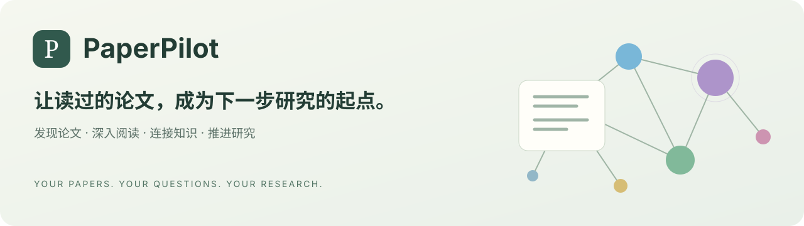
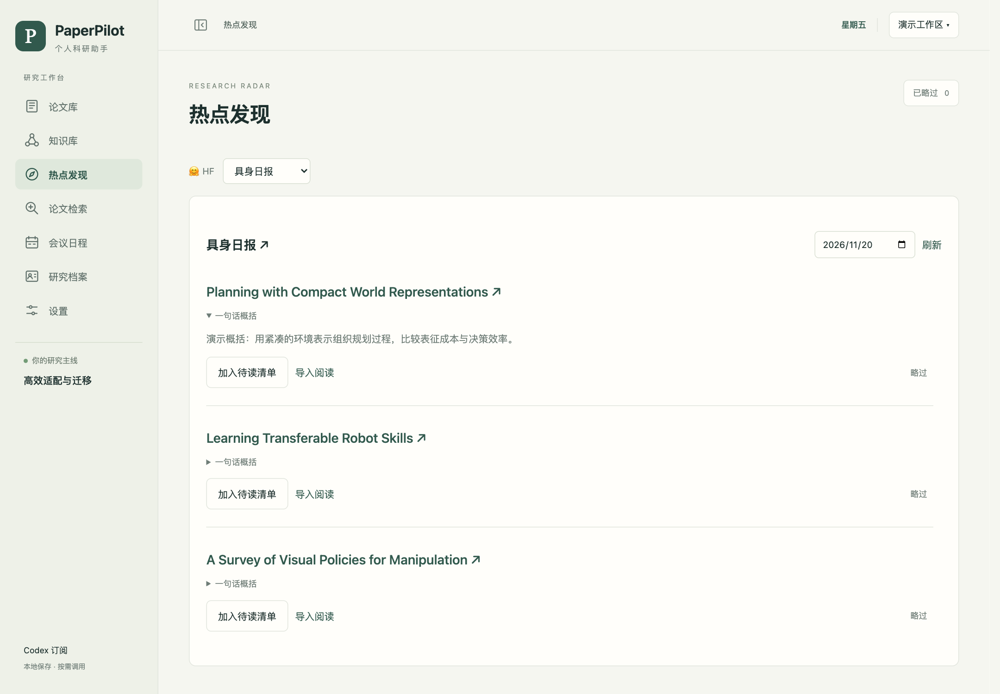
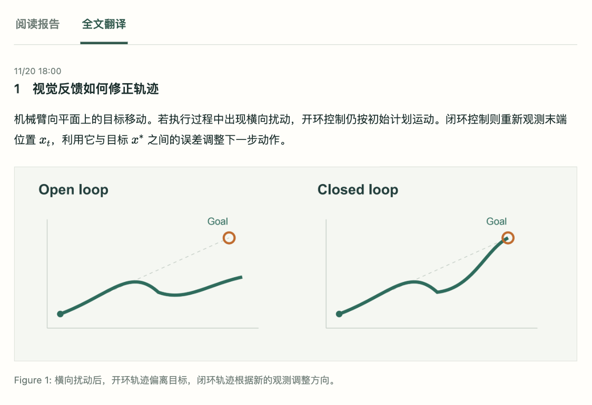
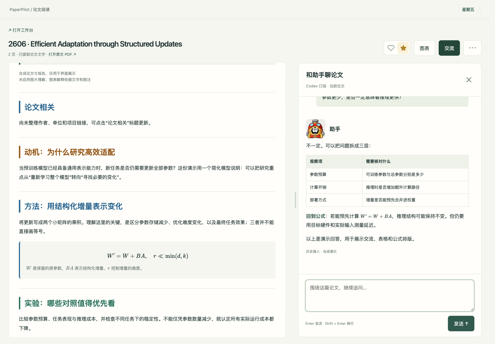
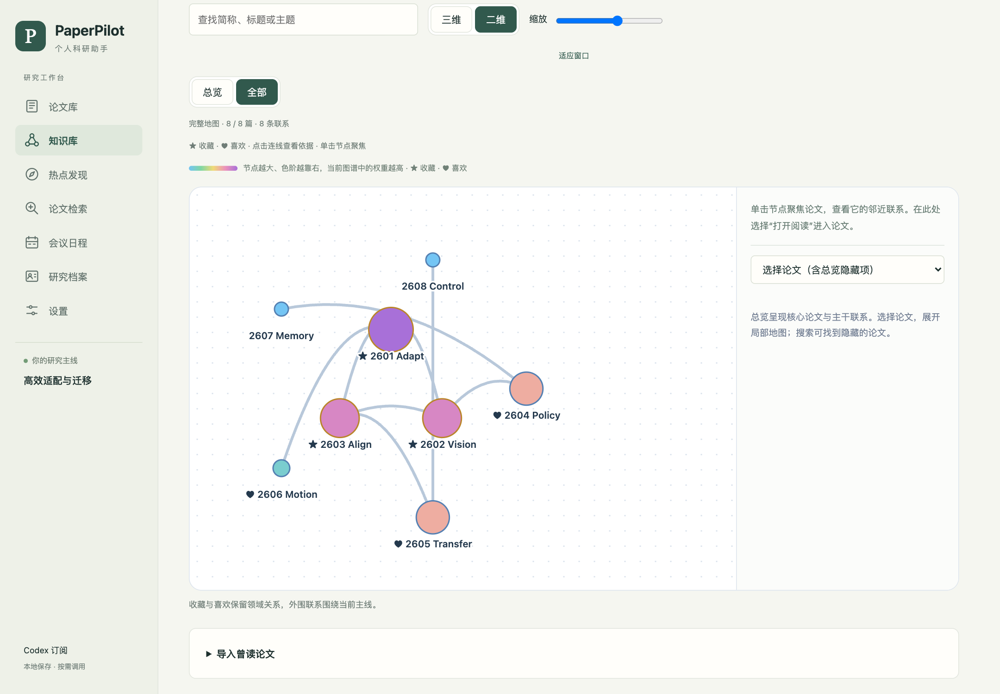
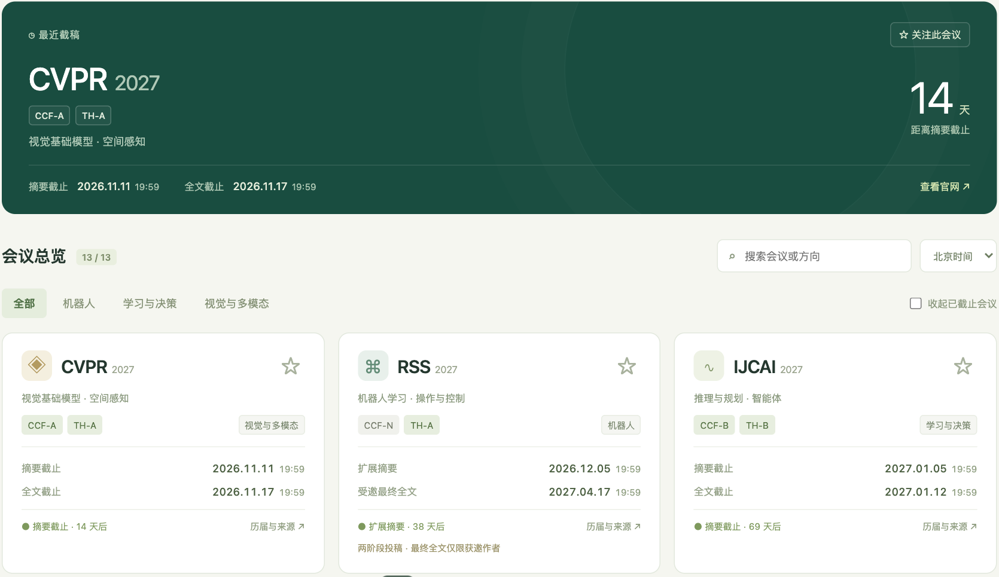

<p align="center">
  
</p>

<p align="center"><strong>简体中文</strong> · <a href="README.en.md">English</a></p>

<p align="center">
  <strong>用中文读懂论文，把值得回看的工作连成自己的知识图谱。</strong><br>
  A local-first research workspace for reading papers and connecting ideas.
</p>

<p align="center">
  <a href="#highlights">核心亮点</a> ·
  <a href="#daily-slides">具身日报 · PPT 速览</a> ·
  <a href="#preview">界面预览</a> ·
  <a href="#quick-start">开始使用</a> ·
  <a href="docs/GETTING_STARTED.md">安装指南</a> ·
  <a href="#contributing">参与共建</a>
</p>

<p align="center">
  本地保存 &nbsp; / &nbsp; Codex · DeepSeek &nbsp; / &nbsp; macOS · Windows
</p>

PaperPilot 是为中文读者设计的本地科研工作台。打开一篇英文论文，可以按原文顺序读中文译文，对照原图和公式；想弄清方法为什么有效，再切到阅读报告。两种读法共用一份摘要和论文信息。

对具身智能研究者，阅读还可以从一份讲解 PPT 开始。每天用日报了解领域进展，哪些论文值得进入自己的研究图谱，由你在阅读中决定。

| 一篇论文值得投入多少注意力？ | 它在图谱里的位置 |
| --- | --- |
| **浏览日报** · 看概括或讲解 PPT，了解工作做了什么 | 无需下载论文 PDF。浏览和加入待读清单都不会产生图谱节点。 |
| **标为已读** · 读过原文，留下自己的判断 | 成为主线图谱的候选，按与具体课题的相关性纳入。 |
| **♥ 喜欢** · 想再借鉴一个方法、一组实验或一种写法 | 纳入长期领域图谱，在展开视图中可以找到。 |
| **★ 收藏** · 值得长期对照、反复回读 | 纳入同一张领域图谱，在总览中优先看到这些论文与精选主干。 |

喜欢和收藏是两种互斥的偏好，在读时就能标记。论文阅读和图谱也适用于其他研究方向，具身日报与会议日程则聚焦具身智能及相关领域。

<a id="highlights"></a>
## 为什么用 PaperPilot

| 你想完成的事 | PaperPilot 如何帮忙 |
| --- | --- |
| **真正读懂论文，而不止得到一段摘要** | 速览、中文精读、数学精读；区分研究论文与综述，自定义叙述顺序，结合公式和原文图表展开。 |
| **随时追问，随时核对** | 阅读报告与论文交流并排显示，宽度可调；支持 Markdown / LaTeX。读到图表有误时可原地调整裁剪和图注。 |
| **把读过的论文串起来** | AI 整理两层知识图谱：长期领域骨架 + 独立研究主线。总览看重点，点选论文后看局部联系和依据。 |
| **让助手理解自己的研究问题** | 手填研究档案、研究方向、最多三条研究主线；推荐、解读和问答参考个人背景，逐篇思考参与图谱整理。 |
| **发现具身论文时，已有讲解 PPT 可看** | 接入具身日报，从 HF 具身方向精选论文直接打开预生成的讲解幻灯片（PDF 阅读版），先看概括与讲解，再决定是否精读。 |
| **把工具改成适合自己的样子** | 支持基于源码 DIY：调整页面、接入新的论文来源、扩展阅读流程与功能模块，也可以让 Codex 等编程助手协助完成。 |
| **让论文库长期保持可用** | 在读、已读、喜欢、收藏四区；导入曾读论文，按需释放原文空间，保留报告及其图片，之后可恢复 PDF。 |

<a id="preview"></a>
## 从阅读到研究

以下为**真实界面配合合成演示数据**的截图。论文、报告和连线仅展示交互，不代表真实论文结论、模型生成质量或个人研究资料。

<a id="daily-slides"></a>
### 01 · 具身日报：新论文，配好讲解 PPT 再来看



**从 HuggingFace 具身智能方向精选论文，到已制作好的讲解 PPT，再到你的个人精读。** [具身日报](https://ipplab.github.io/embodied-ai-daily-papers/)是课题组独立维护的公开项目，PaperPilot 把它接入你的日常科研工作台。

1. **先筛选**：按日期浏览入选论文，展开概括，快速判断是否值得关注。
2. **先看讲解**：点击论文标题，直接打开具身日报已制作的讲解幻灯片，网页端以 PDF 阅读版呈现，无需在 PaperPilot 重新调用模型生成。
3. **再决定读什么**：把候选放进待读清单，准备细读时再导入原文，生成译文或报告，随时追问并记下思考。

需要看更广的内容时，一键切换到 **HF 全量列表**，再用研究方向与主线进行 AI 筛选。具身日报负责公共讲解，PaperPilot 承接个人研究积累。

[查看具身日报](https://ipplab.github.io/embodied-ai-daily-papers/) · [具身日报源码](https://github.com/iPPLab/embodied-ai-daily-papers) · [小红书介绍](https://www.xiaohongshu.com/explore/6b002674000000002b01b47a)

> 讲解由具身日报提供，覆盖与更新进度以该站实际收录为准。PaperPilot 内不生成 PPT；自己的阅读报告仍以 PDF 导出。

### 02 · 读懂一篇论文，也留下自己的问题

先按原文顺序读中文译文。公式、原图和中文图注放在同一处；想深入理解方法时，切到旁边的「阅读报告」。



读报告时可以在旁边展开交流，一边看解读，一边追问公式或实验结果。



- **选择合适的读法。** 研究论文按动机、方法、实验、结论展开；综述有独立的叙述结构。也可以增删、修改步骤，并保存自己的叙述线。
- **数学精读有自己的风格。** 可上传参考例文，选择每次现场阅读，或先提炼风格规范再复用，兼顾个性化与调用消耗。
- **图表能核对，也能修正。** 自动提取后，支持添加、删除、裁剪，以及选取、输入或修正原文图注后翻译。高清裁图按需加载，读报告时也能就地调整。
- **工作不中断。** 多标签页打开不同论文；最多三个报告生成任务并行，其余排队。支持停止生成；交流发错问题可停止并编辑。
- **把理解带走。** 阅读报告可导出为 PDF，保留中文、公式与图表，复用现有报告，不额外调用模型。

### 03 · 让论文关系服务于你的研究



**领域图谱**纳入收藏与喜欢，围绕相对稳定的研究方向组织。**主线图谱**继承领域骨架，再按当前课题连接相关已读论文。切换课题，不必把长期积累推倒重来。

| 视角 | 适合什么时候用 |
| --- | --- |
| **总览** | 看核心论文与精选主干，避免满屏连线。 |
| **全部** | 展开更多层次；主线图谱仍按该主线的相关性筛选。 |
| **单点聚焦** | 查看这篇论文的邻居、机制联系或差异、依据与用途；明确点击“打开阅读”再进入报告。 |

联系分析参考题名、摘要、个人思考与保存的阅读报告；没有报告时使用 PDF 引言，无法定位引言则注明使用开篇片段，并结合可用原文材料核对。事实、类比与待验证迁移分开表达。

支持二维 / 三维浏览、增量更新与重建。可开启每周自动更新：应用未运行时不执行，重新打开后检查补更；没有变化就不调用模型。生成失败保留旧图，已经成功的领域骨架独立保存。

### 04 · 下一个还能投稿的会议，什么时候截止？

会议日程会置顶最近仍可首次投稿的会议，也可以关注一个会议系列。卡片分别列出摘要与全文截止时间，方便看出什么时候必须先注册、哪些阶段仅对已注册或获邀作者开放。



*图中为历史演示快照，实际投稿时间请查看会议官网。*

## 为长期使用准备

**论文检索**：按标题搜索，或把研究问题交给助手持续讨论，再生成推荐候选。感兴趣的先放进待读清单，决定阅读时再导入。

**有层次的论文库。** 待读清单用于候选；在读和已读记录阅读进展；♥ 喜欢与 ★ 收藏互斥，表达不同程度的个人偏好。曾经读过的论文也可以补录，摘要与元信息先入库，PDF 按需获取。

**把空间留给需要的原文。** 支持单篇或批量释放 PDF、删除阅读报告。释放原文后保留现有报告所需图片；有可用来源时可重新下载，也可以手动上传恢复，手动版本优先。可再生高清图片缓存每个账户共享 **512 MiB** 上限，不包含原始 PDF、必须保留的报告图片及导出文件。

**自己的资料，自己的接入。** 多个本地用户分别保存论文、笔记、图谱和模型配置。可选持续记忆默认关闭；更换 Codex / DeepSeek 不会换掉已有资料和图谱，也不改变共同的生成规则。

<a id="quick-start"></a>
## 开始使用

当前采用源码安装。准备 **Python 3.12、Node.js 22 和 Git**，先克隆项目：

```sh
git clone https://github.com/guoyuanhao-git/PaperPilot.git
cd PaperPilot
```

<details open>
<summary><strong>macOS</strong></summary>

```sh
python3 -m venv .venv
.venv/bin/python -m pip install -r requirements.txt
npm ci
npx playwright install chromium
./run.sh
```

安装完成后，可以双击项目内 `PaperPilot.app` 或 `启动 PaperPilot.command`；停止服务使用 `停止 PaperPilot.command`。

</details>

<details>
<summary><strong>Windows · PowerShell</strong></summary>

```powershell
py -3.12 -m venv .venv
.\.venv\Scripts\python.exe -m pip install -r requirements.txt
npm.cmd ci
npx.cmd playwright install chromium
.\run.cmd
```

安装完成后，可以双击 `启动 PaperPilot.cmd` / `停止 PaperPilot.cmd`。没有 `py` 命令时，可使用已安装 Python 的完整路径。

</details>

浏览器打开 **http://127.0.0.1:8765/**。创建本地用户，在“模型设置”选择接入，再导入第一篇论文。

| 接入 | 使用方式 |
| --- | --- |
| **Codex** | 通过本机 Codex CLI 及当前用户的登录调用，使用对应账户的可用额度。 |
| **DeepSeek** | 使用自己的 API Key，按服务商规则计费。 |

页面提供“协助接入”提示词，自动填入项目路径、账户和端口，可交给同机助手完成配置；也可手动配置。**启动和本地管理不需要模型凭据，生成与问答需要有效接入。**

| 平台 | 当前状态 |
| --- | --- |
| **macOS** | 主开发与验证环境。 |
| **Windows** | 原生启停、PDF 导出及 Codex / DeepSeek 核心流程已通过实机验证；具体范围见验证记录。 |
| **Linux** | 尚未完成完整实机验收。 |

完整步骤、数据备份与排错见[安装与使用指南](docs/GETTING_STARTED.md)，具体平台证据见 [Windows 验证记录](docs/WINDOWS_VALIDATION.md)。

## 常见问题

<details>
<summary><strong>本地保存，是否意味着完全离线？</strong></summary>

不是。论文、报告、思考、图谱和设置保存在本机；生成、问答等模型功能会把本次所需材料发送给选定服务，论文检索和日报也需要联网。当前不提供本地离线大模型接入。

</details>

<details>
<summary><strong>能否用于具身智能以外的研究？</strong></summary>

可以。论文阅读、检索、研究档案和知识图谱没有写死个人研究方向。内置日报入口与会议清单更偏向具身智能及相关 AI 领域。

</details>

<details>
<summary><strong>支持参考文献排版、OCR 或 PPT 导出吗？</strong></summary>

当前不提供写作软件引用插件或完整参考文献排版，也未实现扫描 PDF 的 OCR。PaperPilot 自己的阅读报告支持 PDF 导出，不提供 PPT 生成。热点发现中可以打开具身日报预生成的讲解 PPT 的 PDF 阅读版；这是外部项目提供的公共内容，与本地报告生成分开。

</details>

<details>
<summary><strong>数据和密钥放在哪里？</strong></summary>

默认个人数据在 `data/users/<id>/`，可通过 `PAPERPILOT_DATA` 改变数据根目录。DeepSeek Key 在 macOS 使用钥匙串；Windows / Linux 当前保存在账户目录的本地凭据文件。数据不随 Git 同步；备份前请停止服务。

本地用户是工作区隔离，不是公网多租户登录。应用默认仅监听本机，请勿直接开放到公网。模型解读与图谱关系仍需对照原文判断，自动裁图有误时可手动修正。

</details>

<a id="contributing"></a>
## 参与共建

**不只使用 PaperPilot，也可以把它变成自己的科研工具。** 你可以基于源码 DIY：从调整界面和默认配置，到接入新的论文来源、扩展阅读流程与功能模块。你可以自己修改，也可以让 Codex 等编程助手协助，把具体需求逐步实现；不必等待每一个个性化需求都进入主项目。

应用代码、前端和测试分别位于 `paperpilot/`、`web/`、`tests/`，便于从一个小改动开始。修改时请保留个人数据隔离与凭据保护，并运行相关测试。通用改进也欢迎通过 PR 回馈项目。语言适配的扩展边界见[国际化开发说明](docs/LOCALIZATION.md)。

欢迎反馈真实阅读场景中的问题，尤其是论文解析、公式 / 图表显示、交互体验与跨平台兼容。提交问题时请附复现步骤和脱敏截图，不要附上 API Key、登录令牌或个人数据库。

开发前请读 [AGENTS.md](AGENTS.md) 和[协作说明](docs/COLLABORATION.md)。Windows 适配从 [Windows 交接指南](docs/WINDOWS_HANDOFF.md) 开始，保留共同产品行为，通过独立分支和 PR 协作。

<details>
<summary><strong>开发入口与验证命令</strong></summary>

| 路径 | 内容 |
| --- | --- |
| `paperpilot/` | Python 服务、模型适配与业务规则 |
| `web/` | 工作台界面、图谱和会议模块 |
| `tests/` | 单元测试、浏览器及导出验证 |
| `tools/` | 启动、图谱构建、导出与源码打包 |

在独立临时数据目录下运行，避免影响日常资料：

```sh
export PAPERPILOT_DATA="$(mktemp -d)"
.venv/bin/python -m unittest discover -s tests
node --test tests/reader-split.test.cjs tests/conference-rules.test.mjs tests/translation-view.test.cjs
npm run build:graph
.venv/bin/python tests/verify_exports.py
.venv/bin/python tools/package_source.py
```

Windows 临时环境与测试命令见[交接指南](docs/WINDOWS_HANDOFF.md)。真实模型测试需要单独授权，离线测试不代表模型连通成功。

</details>

## 致谢

感谢 [HuggingFace DailyPapers](https://huggingface.co/papers) 与 [具身日报](https://ipplab.github.io/embodied-ai-daily-papers/) 提供论文发现入口，以及项目所使用的 KaTeX、Playwright、3d-force-graph 等工具。界面截图的制作说明见[演示素材说明](docs/assets/readme/README.md)。
